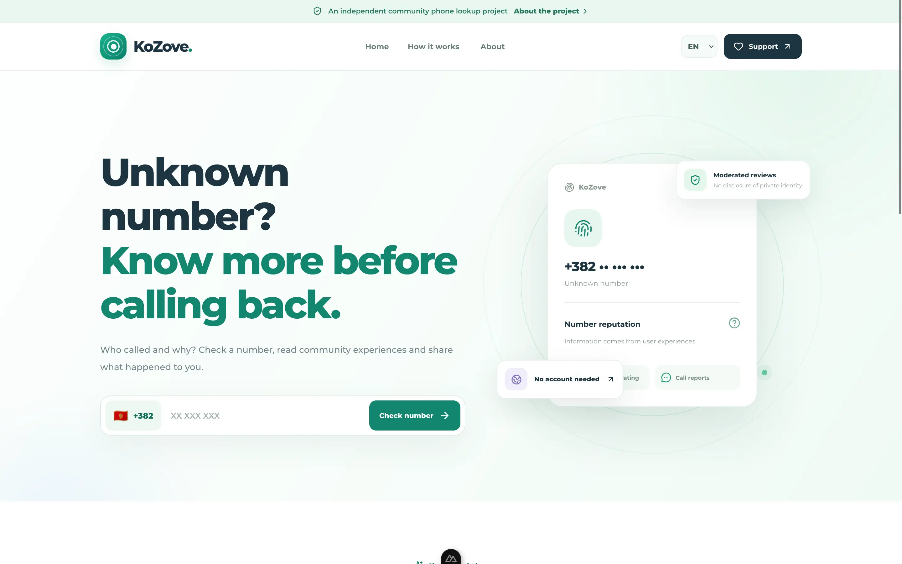
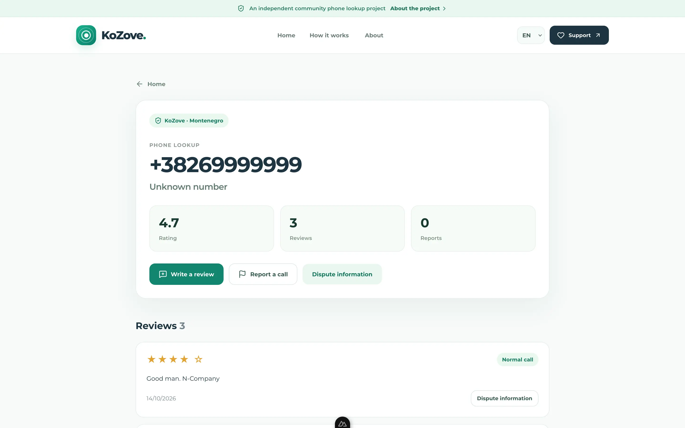
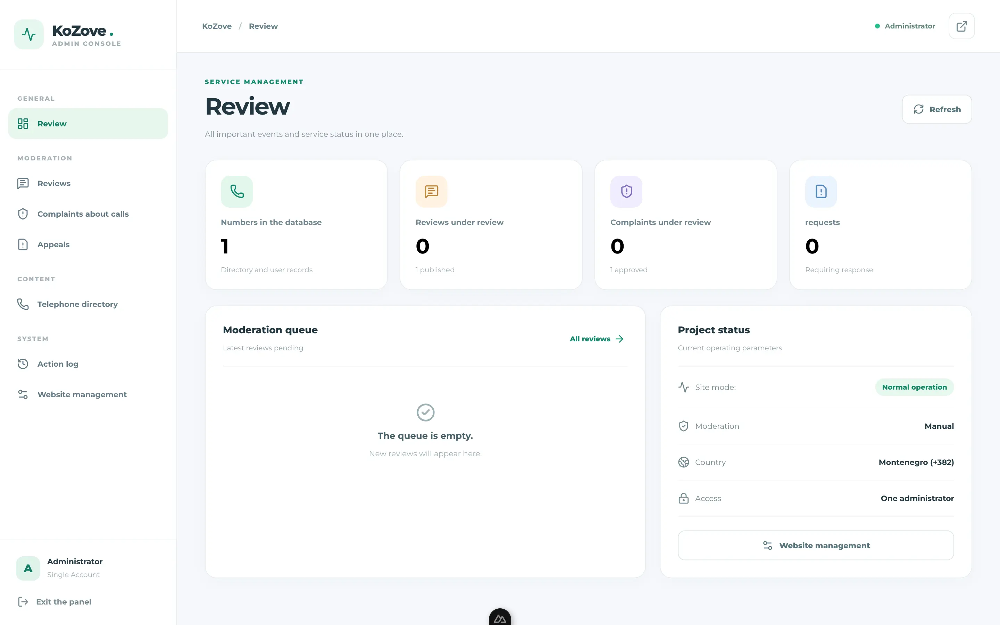

<div align="center">

# 📞 KoZove

**Who's calling? Find out together.**

A free, open-source phone number review platform
starting in **Montenegro (+382)**.

Search numbers, read experiences, and share yours.
No account required.

[](https://github.com/xydojhuk/kozove/releases)
[](LICENSE)
[](#-join-in)

**[Features](#-features) · [Run locally](#-run-locally) · [Contribute](#-join-in)**

</div>

## ✨ Features

- 🔎 **Phone lookup** — search Montenegro's +382 numbers.
- 💬 **Community reviews** — share and read experiences.
- 🛡️ **Manual moderation** — reviews and reports are checked before publication.
- 🌍 **Three languages** — Serbian, English and Russian.
- 🔐 **Admin dashboard** — manage submissions and disputes.
- 🧩 **Open source** — inspect, modify and self-host the code.

KoZove shares community experiences, not verified
identities of private callers. Reports are not proof
of wrongdoing.

## 📸 Screenshots

<p align="center">
  
</p>

<p align="center">
  
  
</p>

## 🚀 Run locally

**Requirements:** Git and Docker Compose.

```bash
git clone https://github.com/xydojhuk/kozove.git
cd kozove
cp .env.example .env
```

Edit `.env` before starting:

- Set a strong `POSTGRES_PASSWORD`.
- Generate independent `ABUSE_PEPPER` and `PROXY_SHARED_SECRET` values.
- Set `ADMIN_PASSWORD_HASH` to an Argon2id hash.
- Set `CONTACT_EMAIL` to an address you control.
- Keep `PUBLIC_ORIGIN=http://localhost:3000` for local use.
- Keep the included Turnstile test keys for development only.

Generate random secrets:

```bash
python -c "import secrets; print(secrets.token_hex(32))"
```

Generate the administrator password hash using the API image:

```bash
docker compose build api
docker compose run --rm --no-deps api python -c 'from getpass import getpass; from argon2 import PasswordHasher; print(PasswordHasher().hash(getpass("Admin password: ")))'
```

Copy the resulting hash to `ADMIN_PASSWORD_HASH` in `.env`.

Start the application:

```bash
docker compose up --build -d
```

**Web:** http://localhost:3000

**API docs:** http://localhost:8000/docs

**Health check:** http://localhost:8000/healthz

> This setup is intended for local development, not public production hosting.

## 🧪 Tests

Create a separate test database:

```bash
docker compose exec db sh -lc 'psql -U "$POSTGRES_USER" -d postgres -c "CREATE DATABASE kozove_test;"'
```

Run backend tests:

```bash
docker compose exec api sh -lc 'export KOZOVE_TEST_DATABASE_URL="${DATABASE_URL%/*}/kozove_test"; python -m pytest -v tests/'
```

Check the frontend build:

```bash
cd apps/web
npm ci
npm run build
```

## 🧰 Tech stack

- **Frontend:** Nuxt 4, Vue 3, TypeScript
- **Backend:** FastAPI, SQLAlchemy, Alembic
- **Database:** PostgreSQL 17
- **Development:** Docker Compose

## 🤝 Join in

Found a bug? [Open an issue](https://github.com/xydojhuk/kozove/issues).

Want to contribute? Fork the repository, create a branch,
make your changes and open a pull request.

Please use synthetic data in tests and screenshots.
Never include real personal data, passwords or API keys.

For vulnerabilities, read [SECURITY.md](SECURITY.md)
instead of opening a public issue.

## 📄 License

KoZove is released under the [MIT License](LICENSE).

<sub>Built with care for an open and useful web.</sub>
